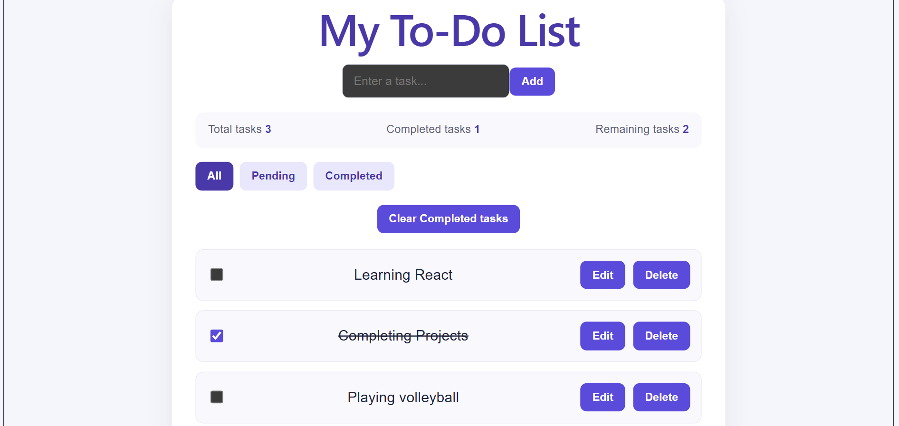

# React To-Do List

A responsive To-Do List application built with React that helps users organize and manage their daily tasks.

## Preview



## Features

- **Add Tasks:** Create new tasks with ease.
- **Complete Tasks:** Mark tasks as completed using checkboxes.
- **Edit Tasks:** Update existing task descriptions.
- **Delete Tasks:** Remove individual tasks.
- **Filter Tasks:** View all, pending, or completed tasks.
- **Clear Completed:** Remove completed tasks after confirmation.
- **Task Summary:** Track total, completed, and remaining tasks.
- **Persistent Storage:** Tasks are saved in the browser's Local Storage and remain available after refreshing the page.
- **Responsive Design:** A layout designed to work across different screen sizes.

## Tech Stack

- React
- JavaScript
- HTML5
- CSS3
- Vite
- Browser Local Storage

## Getting Started

Follow these steps to run the project on your computer.

### Prerequisites

- Node.js
- npm

### Installation

1. Clone the repository:

   ```bash
   git clone YOUR_GITHUB_REPOSITORY_URL
   ```

2. Navigate into the project directory:

   ```bash
   cd todo-internship
   ```

3. Install the dependencies:

   ```bash
   npm install
   ```

4. Start the development server:

   ```bash
   npm run dev
   ```

5. Open the local URL displayed in your terminal.

## Production Build

To check whether the project builds for production, run:

```bash
npm run build
```

## What I Learned

Through this project, I practised:

- Building user interfaces with React components and JSX.
- Managing application state with React Hooks.
- Handling user interactions and events.
- Working with arrays and objects to manage tasks.
- Persisting application data using Local Storage.
- Using Git and GitHub for version control.

## Future Improvements

- Add task priorities and due dates.
- Add search functionality.
- Improve accessibility and keyboard navigation.
- Deploy the application online.

## Author

Mohammed Zaid

GitHub: [mohammedzaid9002](https://github.com/mohammedzaid9002-art/React-To-do-list.git)